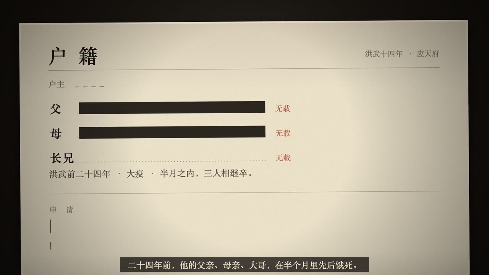
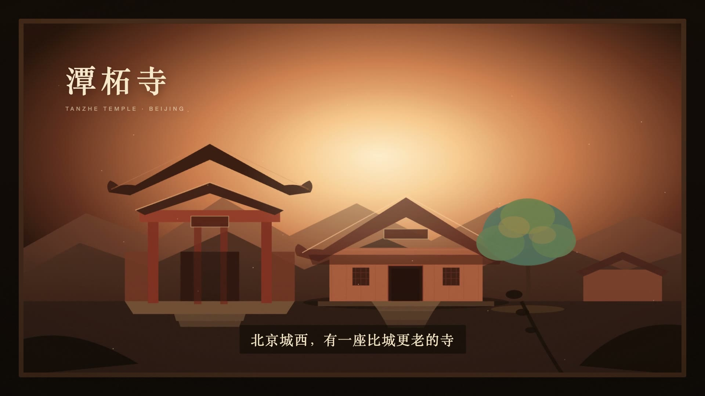

# 鲸片 WhaleReel

> 一句话，六种风格，直接出片。
> 给 DeepSeek 一句话，它自己选风格、搜资料、写脚本、写代码、渲染成一支 30–120 秒的短片。

**没有视频模型，没有 GPU，没有素材库。** 每一帧都是代码画的。

> v0.2：四个真实案例进了仓库——朱元璋、庐州月、北京、潭柘寺。三种新风格（档案卷宗、钢笔淡彩、白模投影）就是为它们做的。

[English](README.en.md) · [安装](INSTALL.md) · [提示语](PROMPTS.md) · [看样片](site/index.html) · [六种风格](#六种风格) · [四个案例](examples/cases.md) · [快速开始](#快速开始) · [路线图](ROADMAP.md)

---

[](renders/00-trailer-v2.mp4)

## 这是什么

鲸片是一个给 DeepSeek 用的视频 skill。你只需要说一句话：

> 做一条朱元璋治国的知识科普，45 秒，16:9，用档案卷宗风格，要旁白和字幕。

它会：

1. 判断该用哪种风格（或照你指定的来）；
2. **先去搜资料、核对出处**，把数字和说法写进 `sources.md`；
3. 写 5–7 拍的分镜脚本；
4. 生成一段自包含的 HTML/CSS/JS 场景；
5. 用 Playwright 逐帧截图，ffmpeg 合成；
6. 按验收清单自检，输出 mp4 + 脚本 + 工程文件。

**它不是文生视频模型。** DeepSeek 不生成像素，它写的是渲染代码。好处是可控、可改、可复现；代价是复杂镜头仍需要人调。

## v0.2 变了什么

| 变化 | 说明 |
|---|---|
| 新增 3 种风格 | 档案卷宗、钢笔淡彩、白模投影——对应四个案例 |
| 退役 3 种风格 | 一笔画、蜡笔绘本、俯视立体，归档在 `archive/v0.1/` |
| 流程加了一道闸 | “搜资料”变成必经步骤；没有来源的数字不上屏 |
| 选风格更明确 | 用户指定就照做；没指定就推荐 2–3 个、说明理由、直接开工 |
| 新样片 | 3 支案例片段 + 6 风格 30 秒混剪（`renders/00-trailer-v2.mp4`） |
| 案例文档 | `examples/cases.md`：四支片子的 brief、资料、结构、坑 |

## 读者 3 步（DeepSeek Harness）

**1. 安装**

```bash
cd whalereel
bash scripts/install-harness.sh   # -> ~/.dsh/skills/whalereel
```

**2. 新建一个 DeepSeek Harness 会话**

不要用装之前的旧会话。

**3. 粘贴提示语**

```
用 whalereel 做一条潭柘寺的景区介绍，45 秒，16:9，用立体纸雕风格。
先给我 5–7 拍脚本和资料出处，我确认后再写场景。
```

没自动加载就 `/whalereel`。六种风格的完整提示语见 [PROMPTS.md](PROMPTS.md)。

> 渲染 mp4 需要本机 Chrome + ffmpeg；首次在 `~/.dsh/skills/whalereel` 里 `npm i playwright`。
>
> 如果新会话没看到 `whalereel`，把脚本参数换成 `~/.agents/skills` 再装一次：
> `bash scripts/install-harness.sh ~/.agents/skills`。不要两处同时放。

## 六种风格

| 风格 | 适合 | 一句话视觉 | 开拍前要有 | 样片 |
|---|---|---|---|---|
| [档案卷宗](styles/dossier/STYLE.md) | 历史、案件、制度、调查 | 一张米色卷宗纸，涂黑条盖住名字，印章落下 | 3–6 条有出处的事实 | [24s](renders/cases/dossier.mp4) |
| [钢笔淡彩](styles/pen-wash/STYLE.md) | 情绪、乡愁、城市漫游 | 先有线，后有颜色；颜色跟着一件事走 | 一个地点 + 一个颜色事件 | [30s](renders/cases/pen-wash.mp4) |
| [白模投影](styles/white-model/STYLE.md) | 城市、区域、规划、人口 | 纯白模型在暗房，投影把数据一层层刷上去 | 真实轮廓 + 高度 + 地形 | [30s](renders/cases/white-model.mp4) |
| [立体纸雕](styles/paper-diorama/STYLE.md) | 景区、古建、地标、节日 | 暖光穿过 5–7 层纸，镜头逐层推进 | 点位、年代、一句地方说法 | [8s](renders/01-paper-diorama.mp4) |
| [白板讲解](styles/whiteboard/STYLE.md) | 知识、原理、流程、课程 | 一支马克笔，边画边讲 | 一个能画出来的结构 | [8s](renders/02-whiteboard.mp4) |
| [水墨](styles/ink-wash/STYLE.md) | 山水、古寺、诗词、品牌片头 | 留白、墨韵、一枚朱印 | 一处景或一句诗 | [8s](renders/04-ink-wash.mp4) |

**为什么是六种？** 因为每一种都要配一份契约、一支样片、一套验收清单，还要有一个真实案例证明它能用。六种能保证每一种都真的能出片；五十种只能保证“看起来很多”。

## 四个案例

| 案例 | 风格 | 时长 | 看点 |
|---|---|---:|---|
| [朱元璋](examples/cases.md) | 档案卷宗 | 130s（3 集） | 涂黑条盖住名字；落印时全屏抖一下 |
| [庐州月](examples/cases.md) | 钢笔淡彩 | 60s | 无旁白；颜色只跟着一盏灯笼走 |
| [北京](examples/cases.md) | 白模投影 | 120s | 11,308 栋真实建筑；每个数字有出处 |
| [潭柘寺](examples/tanzhe-temple.md) | 立体纸雕 | 45s | 火柴开场 → 山门滑出 → 晨暮 → 落印 |

`renders/cases/` 里是前三支的 24–30 秒片段，用于展示风格；潭柘寺是完整 45 秒正片（`renders/01-tanzhe-45s.mp4`）。

## 45 秒正片：潭柘寺

[](renders/01-tanzhe-45s.mp4)

1920×1080 / 24fps / 45.0s / 有声。火柴开场 → 山门滑出 → 晨暮 → 拉远 → 落印。工程在 `output/tanzhe-45s/`（brief / script / sources / qa / 配乐）。

## 30 秒混剪

[](renders/00-trailer-v2.mp4)

3 秒片头 + 六段各 4 秒 + 3 秒片尾，1280×720 / 24fps / 无声。全部由本项目的场景代码渲染（案例片段来自对应项目）。

## 一句话怎么用

```
用 whalereel 做一条 <主题>，<时长>，<画幅>，用 <风格> 风格。
<要不要旁白/字幕/音乐>，结尾 <落在哪>。
先给我脚本和资料出处，我确认后再写场景。
```

例子：

- 做一条朱元璋治国的知识科普，45 秒，16:9，用档案卷宗风格。
- 做一条 60 秒的情绪短片，主题是“三月夜里回到老家”，用钢笔淡彩，无旁白。
- 做一条成都的城市介绍，120 秒，用白模投影，每个数字给出来源。
- 做一条潭柘寺的景区介绍，45 秒，用立体纸雕，结尾露出“先有潭柘寺，后有北京城”。
- 讲清楚什么是 RAG，60 秒，给产品经理看，用白板讲解。

## 风格怎么选

| 你想要观众… | 选 |
|---|---|
| 去查、去相信 | 档案卷宗 |
| 被打动 | 钢笔淡彩 |
| 看清一个地方 / 一组数据 | 白模投影 |
| 想去这个地方 | 立体纸雕 |
| 看懂一件事 | 白板讲解 |
| 静下来 | 水墨 |

如果两个都合适，按“观众看完应该做什么”来选：查、感动、看清、去、懂、记住。

**不要这样选**：有数据但没来源，不要用白模投影；有史料但核不出来，不要用档案卷宗；想讲三步流程，不要用水墨。

## 一份 STYLE.md 有什么

九个 section，缺一不可：

1. 格式（含**资料清单**：这个风格开拍前必须找到什么）
2. 视觉契约（色板 ≤6 色、字体、材质、版式）
3. 镜头契约（机位、运动、焦点、转场、节奏）
4. 声音契约
5. 分镜模板
6. 风格提示词（可直接复制）
7. 禁止项
8. 验收清单
9. 参考

**风格是契约，不是滤镜。** 色板、镜头、声音、禁止项，缺一不可。契约之外的部分——故事、结构、镜头顺序——由你定。

## 快速开始

### 方式 A：装进 DeepSeek Harness（推荐）

```bash
git clone https://github.com/xiaoyao-tech/whalereel.git whalereel
cd whalereel
bash scripts/install-harness.sh
# 默认安装到 ~/.dsh/skills/whalereel
```

项目级安装（只在当前项目可见）：

```bash
bash scripts/install-harness.sh /path/to/project/.dsh/skills
```

装完新建一个会话，粘贴：

```
用 whalereel 做一条潭柘寺的景区介绍，45 秒，16:9，用立体纸雕风格。
```

### 方式 B：只用提示词

打开任意一个 `styles/<slug>/STYLE.md`，复制“风格提示词”一节，粘贴给 DeepSeek，再附上你的主题和时长。没有 Harness 也能用，只是不会自动选风格、搜资料、渲染。

### 方式 C：本地跑样片

需要 Node 18+、ffmpeg、本机 Chrome。

```bash
npm install
npm run render:demos     # 三支 8 秒样片 -> renders/
open site/index.html     # 自动播放的画廊
```

只渲染一支：

```bash
node render/render.mjs scenes/01-paper-diorama.html renders/01.mp4 \
  --width 1280 --height 720 --duration 8 --fps 24 --channel chrome
```

## 项目结构

```
whalereel/
├── SKILL.md                 # 一句话 -> 成片的完整流程
├── README.md
├── INSTALL.md               # Harness 安装三步
├── PROMPTS.md               # 六种风格的读者提示语
├── ROADMAP.md
├── index.json               # 六种风格的机器可读索引
├── styles/
│   ├── _template/STYLE.md
│   ├── dossier/STYLE.md          # 档案卷宗
│   ├── pen-wash/STYLE.md         # 钢笔淡彩
│   ├── white-model/STYLE.md      # 白模投影
│   ├── paper-diorama/STYLE.md    # 立体纸雕
│   ├── whiteboard/STYLE.md       # 白板讲解
│   └── ink-wash/STYLE.md         # 水墨
├── templates/{brief,script,qa,sources}.md
├── examples/
│   ├── cases.md             # 四个案例：brief / 资料 / 结构 / 坑
│   └── tanzhe-temple.md     # 同一座寺的三种拍法
├── scenes/                  # 三支 8 秒样片的 HTML 场景
├── renders/                 # 样片 + 案例片段 + 混剪
├── previews/                # 封面 jpg
├── site/index.html          # 六种风格画廊
├── render/                  # render.mjs + techniques.md
├── scripts/                 # 安装 / 渲染 / 封面 / 校验
├── archive/v0.1/            # 退役的三个风格（一笔画/蜡笔/俯视）
└── assets/logo.svg
```

## 设计原则

1. **一种风格只解决一类问题。** 不追求数量，追求每一种都能直接用。
2. **先资料，后脚本。** 没有出处的数字不上屏；宁可少讲一个。
3. **风格是契约，不是滤镜。** 色板、镜头、声音、禁止项，缺一不可。
4. **先看脚本，再写代码。** 脚本立不住，换风格也救不了。
5. **2D 优先，能跑就行。** 不依赖 GPU，不依赖视频模型，普通笔记本能渲染。
6. **可复现。** 同一份脚本 + 同一份 STYLE.md，应该得到同一支片子。

## 诚实说明

- “一句话”指的是**输入**，不是零修改。第一版通常要改 1–3 次。
- 这不是文生视频。复杂运镜、真实人脸、连续动作，仍然做不好。
- **声音是短板**：自带方案是 TTS + 合成音乐，正式片建议真人配音。
- 白模投影需要真实数据；没有数据就换风格，不要编。
- 档案卷宗、白模投影两个风格改写自 Lemo-Opuscar（CC BY 4.0），已重写为中文语境，署名见 [CREDITS.md](CREDITS.md)。
- 所有事实、数字、引语，发布前必须人工核对。
- 字体和音乐请使用 OFL / CC0 / 已授权素材。

## Roadmap

- v0.1：6 种风格 + 渲染器 + 样片 + 案例（已完成）
- v0.2：三个案例风格进库 + 搜资料流程 + 四个案例文档（当前）
- v0.3：木刻版画 / 产品拆解 / 数据叙事；竖屏模板；批量渲染
- v0.4：声音包（TTS + 配乐 + 混音）；一键出 srt

详见 [ROADMAP.md](ROADMAP.md)。

## 贡献

加一种风格 = 一份 `STYLE.md`（9 节）+ 一支 10 秒测试片 + 一条 `index.json` 记录，然后：

```bash
node scripts/validate-styles.mjs
```

详见 [CONTRIBUTING.md](CONTRIBUTING.md)。

## 许可与署名

- 代码 MIT，文档 CC BY 4.0。
- 风格库的组织方式与部分语法参考 [LemoLab · Lemo-Opuscar](https://github.com/lemomo-ai/lemo-opuscar)（代码 MIT，风格文档与样片 CC BY 4.0）。
- `pen-wash` 改写自其 `urban-sketch`；`white-model` 改写自其 `white-model`。均已重写，不是原样复制。
- 字体遵循各自 OFL 协议。
